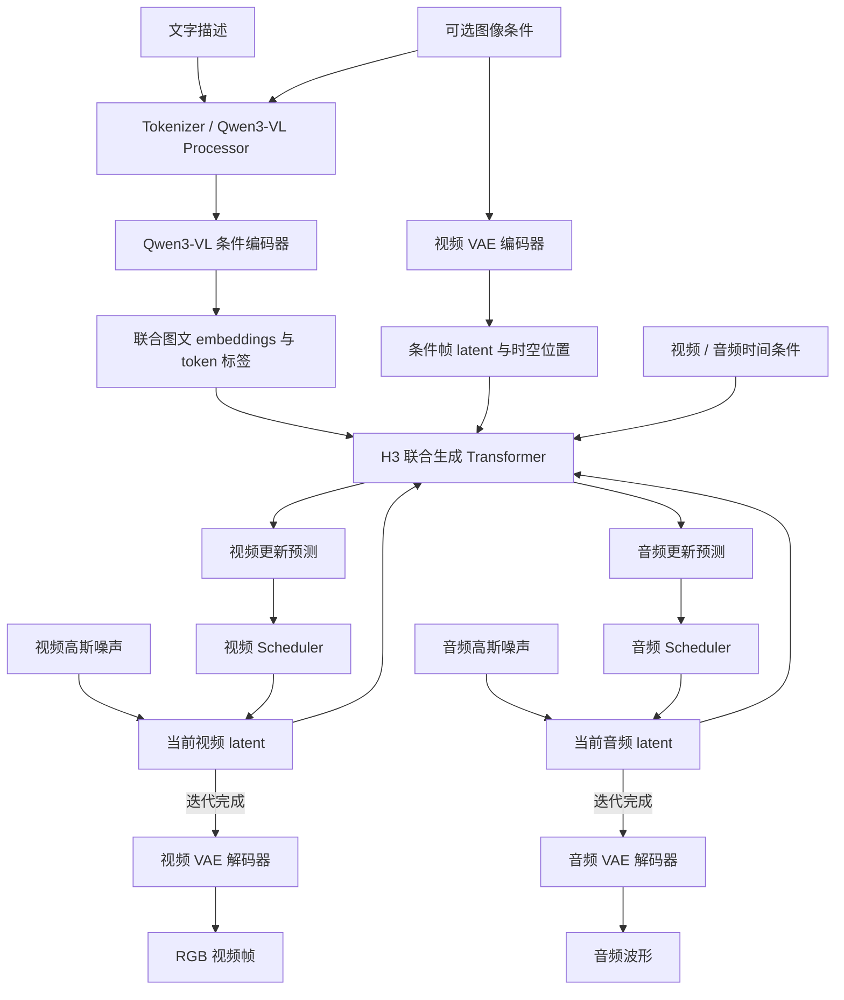
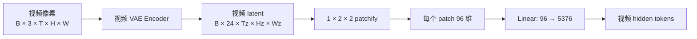
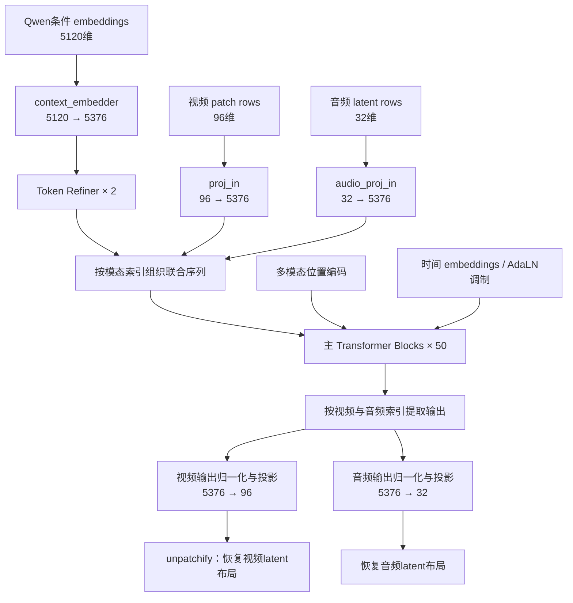
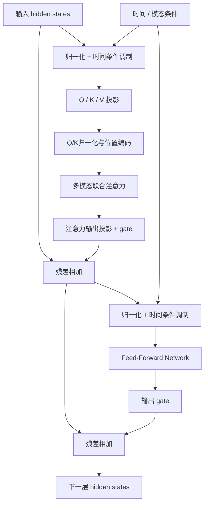
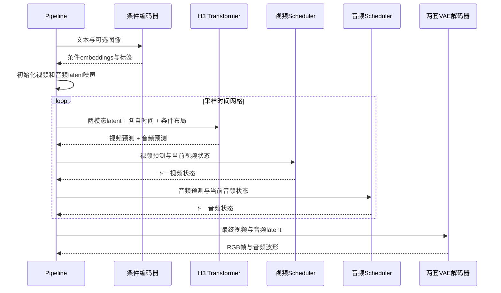
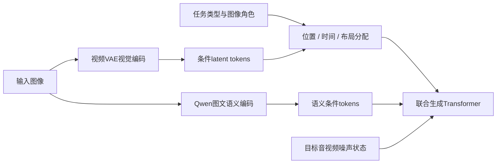

本文关注 MiniMax-H3 的通用生成架构，事实依据是本地 `MiniMaxAI/MiniMax-H3` checkpoint 配置，以及安装环境中 Diffusers 0.40.0 的原生 H3 实现。

## 1. 总览

H3 可以理解为一个在压缩潜空间中，对视频和音频进行联合建模、联合迭代生成的多模态系统。

它不是一个单独的“大视频 Transformer”，也不是“先生成视频，再找一个配音模型补上声音”。完整系统分为三个层次：

1. 条件理解层：把文字、图像等输入转换成模型可用的语义表示。
2. 联合生成层：在视频与音频各自的潜空间中，用共享 Transformer 建模两者及条件之间的关系。
3. 媒体重建层：分别将最终潜变量解码为 RGB 视频与音频波形。

这三个层次对应不同组件，不能把条件编码器的参数量、生成主干的参数量和整个 pipeline 的参数量混为一谈。

## 2. 系统总图：语义条件、生成状态、媒体输出

读图要点：

- 图中的循环是去噪/流积分的迭代，不是自动意味着按视频帧自回归。
- 图像可以同时形成“语义条件”和“视觉 latent 条件”，两条支路的作用不同。
- 视频与音频共享生成主干，但各自保留输入投影、输出头、VAE和Scheduler。
- 上图是概念总图；具体任务会启用不同条件支路。

## 3. 各组件功能详解

| 组件 | 本地声明的类型 | 主要职责 |
|---|---|---|
| 条件编码器 | `Qwen3VLForConditionalGeneration` | 提取文字与图像的联合语义表示 |
| 文本处理 | `Qwen2TokenizerFast` | 将文本转换成离散token |
| 图文预处理 | `Qwen3VLProcessor` | 图像预处理及图文输入组织 |
| 视频VAE | `AutoencoderKLMiniMaxH3` | 在RGB视频与视频latent之间转换 |
| 音频VAE | `AutoencoderKLMiniMaxH3Audio` | 在音频波形与音频latent之间转换 |
| 生成主干 | `MiniMaxH3Transformer3DModel` | 多模态潜变量的联合变换与更新预测 |
| 视频Scheduler | `MiniMaxH3Scheduler` | 按视频时间网格更新视频latent |
| 音频Scheduler | `MiniMaxH3Scheduler` | 按音频时间网格更新音频latent |

## 4. 三种表示空间：原始媒体 → latent → token

### 4.1 视频

本地生成模型配置：

- 视频latent通道数：24；
- 视频patch大小：`(1, 2, 2)`；
- 每个视频patch原始宽度：`24 × 1 × 2 × 2 = 96`；
- `proj_in` 将96维输入投影为5376维隐藏表示。

若latent形状为 `24 × Tz × Hz × Wz`，且空间尺寸可被2整除，那么视频token数为：

$$
N_v=T_z\frac{H_z}{2}\frac{W_z}{2}.
$$

例如，仅作尺寸算例：当 `Hz=48、Wz=84` 时，每个latent时间位置对应1008个视频token。

视频VAE时间维存在分块、因果填充等边界处理，不能对任意长度简单写成 `Tz=T/常数`。特别是单图像条件与一整段视频的编码路径，其时间边界不能想当然地互换。

### 4.2 音频

音频不会先变成视频patch。其latent通道数为32，经独立的 `audio_proj_in` 投影到同一5376维隐藏宽度。

视频和音频的时间采样密度不同，所以它们的token数量不必相等。联合生成需要处理的是它们在同一事件时间上的关联，而不是让一个音频token机械对应一个视频token。

### 4.3 文本&参考图（Qwen）

本地条件embedding宽度为5120。`context_embedder` 将其映射为5376维，再通过两层token refiner，进入主干所需的条件表示空间。

统一hidden size不等于三种输入丢失了模态身份。序列位置、模态标记和各自的时间条件仍被保留。

## 5. 联合Transformer：先投影，再打包，最后按模态取回输出

这一设计可以概括为：

> 独立输入适配 + 共享深层交互 + 独立输出适配。

原生前向接口接收布局、模态索引、位置和时间索引，pipeline负责构造这些信息。

## 6. Transformer Block介绍

从功能上看，主block由“时间调制的注意力分支”和“时间调制的前馈分支”组成，两条分支均有残差连接。

### 6.1 时间调制作用

同一段噪声latent在“几乎全噪声”和“接近干净数据”时，需要的更新行为不同。Transformer不仅要看内容，还必须知道当前噪声状态。

AdaLN类调制可以写成以下概念形式：

$$
\operatorname{Modulate}(h,c)=(1+s(c))\odot\operatorname{Norm}(h)+b(c),
$$

其中条件 `c` 来自时间embedding等信息，`s` 和 `b` 是按条件得到的缩放和偏移；分支残差还可以有独立gate。

H3的时间索引允许不同token角色关联不同的时间条件。例如条件图像和待生成视频不必具有相同噪声等级，音频与视频也不必共用完全相同的噪声时间。

### 6.2 配置

| 参数 | 本地checkpoint值 |
|---|---:|
| 主block数量 | 50 |
| token refiner层数 | 2 |
| hidden size | 5376 |
| attention heads | 56 |
| head dimension | 128 |
| Q/K/V各自投影宽度 | 7168 = 56×128 |
| FFN中间维度 | 14336 |
| 文本条件输入宽度 | 5120 |
| 视频/音频latent通道 | 24 / 32 |
| 时间嵌入hidden/output配置 | 5376 / 2688 |

这里 `5376 ≠ 56×128` 非笔误：Q/K/V投影从主隐藏宽度映射到不同的注意力内部宽度，注意力输出再投回5376维。

## 7. 多模态位置编码

视频patch有时间、纵向、横向三个坐标；文本token和音频token也需要自己的序列/时间组织。H3使用多模态旋转位置编码，使这些信息进入注意力的Q/K表示。

## 8. 联合生成

条件embedding通常在采样循环之前计算。随后pipeline维护两份不断变化的状态：视频latent和音频latent。

### 8.1 音频与视频需要各自的Scheduler的必要性

两种模态共享事件内容，却具有不同的分布、压缩方式和噪声敏感性。接口因此保留独立的视频/音频调度器，分别决定时间网格及latent更新。

timestep shift改变的是采样网格分布，不是视频播放速度。FPS、生成帧数、音频采样率又是另一组媒体参数，不能与去噪步数混淆。

### 8.2 流模型的方向

一种常用解释记法是：令 `z` 为干净latent、`ε` 为噪声，定义数据方向时间 `t`：

$$
x_t=(1-t)\epsilon+t z.
$$

则理想速度为：

$$
\frac{\mathrm d x_t}{\mathrm d t}=z-\epsilon.
$$

生成从噪声端走向数据端。如果实现改用 `σ=1-t` 表示噪声量，时间与速度符号也会相应变化。

## 9. 条件任务

Minimax H3 声明了 `FL2VA` 和 `Ref2VA` 两个任务家族入口。它们体现了同一联合生成架构下不同的条件组织方式。

- 首尾帧条件：输入图像对应指定时间位置，约束视频的起点、终点或过渡。
- 参考图条件：图像提供外观/主体等视觉信息，不必代表输出视频的某个固定时刻。

## 10. 常见误解

| 误解 | 更准确的表述 |
|---|---|
| H3就是Qwen生成视频 | Qwen提供条件表示，H3 Transformer生成音视频latent |
| 视频和音频使用同一个VAE | 两者有各自的VAE与潜空间 |
| joint模型只有一个输出头 | 主干共享，视频/音频输入与输出投影不同 |
| hidden size必须等于heads×head dim | 本地H3配置分别为5376和7168 |
| 有causal VAE就是流式生成 | VAE因果性、注意力因果性与采样流式性需要分开验证 |
| 首尾帧与参考图只是换个prompt | 图像角色、视觉latent、位置和布局都可能不同 |
| 两个Transformer字段证明双专家同时运行 | 要看任务路由，索引字段本身不足以支持结论 |

## 术语速查

| 术语 | 在本文中的含义 |
|---|---|
| latent | VAE编码后的连续潜变量，不是离散词表token |
| patchify | 将latent按局部块展平为token行，不是再训练一个编码器 |
| token refiner | 条件embedding进入主干前的适配网络，不是最终视频增强器 |
| joint attention | 不同模态在同一注意力计算框架内发生交互 |
| AdaLN | 由时间等条件控制的归一化调制 |
| RoPE | 作用于注意力Q/K的旋转位置编码 |
| scheduler | 管理采样时间网格与状态更新，不是训练学习率调度器 |
| sampling step | 一次采样迭代，不是一个视频帧 |

